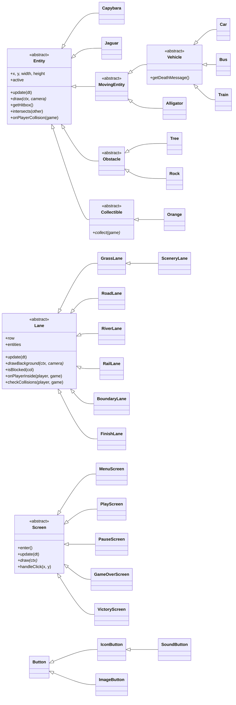
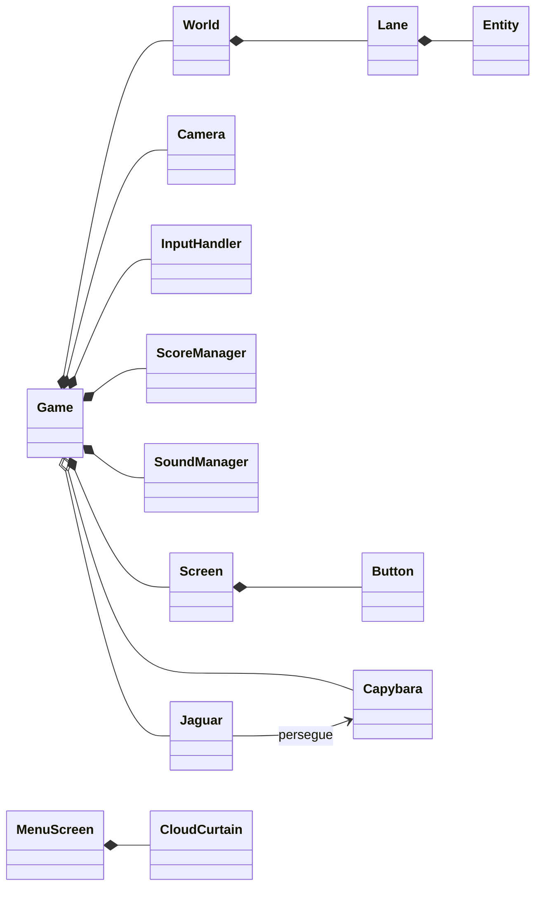

# Capybara Road 🦫🍊

Jogo 2D de navegador inspirado em **Crossy Road** e **Frogger**, feito em JavaScript puro com HTML5 Canvas.
Ajude a capivara a atravessar estradas, rios e trilhos até a linha de chegada, antes que a onça a alcance.

Projeto da **NI1 de Programação Orientada a Objetos** — ADS, turma 2NAADS.

## Integrantes

- Matheus Gajewski de Melo
- Mel Oliva Motta
- Rayna Guimarães Froes

## Como executar

Não precisa instalar nada.

1. Baixe ou clone o repositório.
2. Abra o arquivo `index.html` em um navegador atualizado (Chrome, Edge ou Firefox).

Também funciona com a extensão **Live Server** do VS Code.

## Como jogar

| Tecla | Ação |
| --- | --- |
| Setas ou W A S D | Andar (um quadrado por toque) |
| P ou Esc | Pausar e continuar |
| M | Ligar e desligar o som (também há um botão na tela) |

- Atravesse as **100 faixas** do mapa até a linha de chegada.
- Cuidado com **carros**, **ônibus**, **trens** e **jacarés**.
- A **onça** persegue a capivara por trás: quem fica parado muito tempo é alcançado.
- No rio, a capivara **nada**.
- Árvores e pedras bloqueiam o caminho, mas sempre existe uma passagem livre.
- O jogo pausa sozinho se você trocar de aba ou de janela.

### Pontuação

| O quê | Pontos |
| --- | --- |
| Cada faixa nova alcançada | +10 |
| Cada laranja coletada 🍊 | +50 |
| Medalha de ouro (até 0,9 s por faixa, em média) | +500 |
| Medalha de prata (até 1,2 s por faixa) | +300 |
| Medalha de bronze (até 1,6 s por faixa) | +150 |

As medalhas só valem ao chegar ao fim do mapa e são calculadas pelo **ritmo médio**, então o tempo de pause não conta.
O recorde fica salvo no navegador.

## Estrutura do projeto

```
capybara-road/
├── index.html            Página do jogo; carrega os scripts na ordem certa
├── css/style.css         Aparência da página ao redor do jogo
├── assets/images/        Imagens do menu
├── assets/sounds/        Efeitos sonoros
└── js/
    ├── config.js         Constantes, funções utilitárias e paleta de cores
    ├── main.js           Ponto de partida: cria o jogo
    ├── core/             O "motor": loop, câmera, teclado e pontuação
    ├── entities/         Tudo o que existe no mapa (capivara, veículos, onça...)
    ├── lanes/            Os tipos de faixa (grama, estrada, rio, trilho...)
    ├── world/            O mapa: monta e guarda as faixas
    ├── screens/          As telas (menu, jogo, pause, derrota, vitória)
    └── ui/               Botões e a cortina de nuvens do menu
```

O projeto usa scripts comuns em vez de módulos (`import`/`export`) para funcionar abrindo o `index.html` direto, sem servidor.
Por isso, no `index.html`, as classes-mãe sempre são carregadas antes das filhas.

## Programação Orientada a Objetos

### Diagrama de classes (herança)



Os métodos marcados com `*` são **abstratos**: a classe-mãe não os implementa, e cada filha é obrigada a implementar o seu.

### Composição (quem tem quem)



O `Game` tem o mundo, a câmera, o teclado, o placar e as telas.
O `World` tem as faixas, e cada `Lane` tem as suas entidades (carros, árvores, laranjas...).
A onça **conhece** a capivara (associação) para saber quem perseguir.

### Onde cada conceito aparece

| Conceito | Onde está no código |
| --- | --- |
| **Classes e objetos** | Todas as classes do projeto. Ex.: `new Car(x, y, speed)` cria um objeto carro em `RoadLane.createVehicles()` |
| **Classes abstratas** | `Entity`, `MovingEntity`, `Vehicle`, `Obstacle`, `Collectible`, `Lane` e `Screen`. O JavaScript não tem `abstract`, então o construtor usa `new.target` para impedir `new Entity()` |
| **Herança** | Até quatro níveis: `Entity → MovingEntity → Vehicle → Car`. Outro exemplo: `Lane → GrassLane → SceneryLane` (a floresta "é uma" faixa de grama com árvores em todas as colunas) |
| **Sobrescrita** | `update()`, `draw()`, `getHitbox()`, `onPlayerCollision()`, `isBlocked()`, `drawBackground()`, entre outros |
| **Polimorfismo** | Ver a seção abaixo |
| **Encapsulamento** | `ScoreManager` usa campos e métodos **privados** (`#maxRow`, `#highScore`, `#calculateMedal()`...). Fora da classe, os valores só são lidos por getters e alterados pelos métodos que ela oferece |
| **Composição** | `Game` tem `World`, que tem `Lane`, que tem `Entity` |
| **Membros estáticos** | Constantes como `GrassLane.ORANGE_CHANCE` e `ScoreManager.MEDALS`, e métodos como `Orange.drawIcon()` |

### Polimorfismo: o exemplo principal

Quando a capivara encosta em algo, a faixa chama **sempre o mesmo método**, sem saber o tipo da entidade:

```js
// Lane.checkCollisions()
for (const entity of this.entities) {
    if (entity.active && entity.intersects(player)) {
        entity.onPlayerCollision(game); // cada classe reage do seu jeito
    }
}
```

Cada classe responde de uma forma diferente:

| Entidade | O que acontece |
| --- | --- |
| `Car`, `Bus`, `Train` | Atropelam (cada um com a sua mensagem, via `getDeathMessage()`) |
| `Alligator` | "Virou lanche de jacaré!" |
| `Tree`, `Rock` | Nada (herdam o método vazio de `Entity`) |
| `Orange` | Some e dá +50 pontos |

Não existe nenhum `if (é carro)` ou `if (é laranja)`. Para criar um item ou perigo novo, basta uma nova subclasse: este código não muda.

O mesmo princípio aparece em outros lugares:

- **Faixas:** o `World` chama `lane.drawBackground()` e `lane.isBlocked()`, e cada tipo de faixa responde do seu jeito. A `FinishLane` usa `onPlayerInside()` para declarar a vitória, e a `RiverLane` responde `isWater = true` para a capivara nadar.
- **Telas (padrão State):** o `Game` só chama `currentScreen.update()` e `currentScreen.draw()`. Menu, jogo, pause, derrota e vitória são classes diferentes, cada uma com o seu comportamento.
- **Botões:** a tela chama `button.contains()` e `button.draw()`. O `IconButton` (pause) testa um círculo em vez de um retângulo, e o `ImageButton` (menu) usa uma imagem.

### Padrões de projeto usados

| Padrão | Onde |
| --- | --- |
| **State** | As telas (`Screen` e subclasses) e as máquinas de estado do trilho (`RailLane`), da onça (`Jaguar`) e da cortina do menu |
| **Template Method** | `Vehicle.onPlayerCollision()` usa `getDeathMessage()`, que cada veículo define; `Collectible.onPlayerCollision()` chama `collect()`; `Button.draw()` chama `drawBody()` e `drawLabel()` |
| **Factory Method** | `World.createLane()` decide qual tipo de faixa criar em cada linha do mapa |

## Créditos

- **Inspiração:** Crossy Road (Hipster Whale) e Frogger (Konami).
- **Bíblia visual** (paleta, estilo dos personagens e da interface): <a href="https://github.com/melolivaa">Mel Oliva Motta</a>.
- **Arte do menu:** gerada com ChatGPT (OpenAI) e adaptada pelo grupo (recortes do logo, do botão e da camada de nuvens).
- **Fontes:** [Baloo 2](https://fonts.google.com/specimen/Baloo+2) e [Nunito](https://fonts.google.com/specimen/Nunito) (Google Fonts), sob a SIL Open Font License. Os arquivos ficam em `assets/fonts`, junto das licenças, para o jogo funcionar sem internet.
- **Sons:**
  - [Kenney](https://kenney.nl) (licença CC0): pacotes *Interface Sounds* (pulo, laranja, clique), *Impact Sounds* (atropelamento, mordida do jacaré) e *Music Jingles* (vitória e derrota).
  - [Pixabay](https://pixabay.com/sound-effects/) (Pixabay Content License): "Lion Roar AI Cinematic", de virtualzero (onça); "Loud Train Horn Blast with High Speed Flyby", de chrysalyn (trem); e "Splashing Water", de DRAGON-STUDIO (água).
  - Os sons foram cortados, convertidos para MP3 e tiveram o volume ajustado pelo grupo.
- **Desenvolvimento:** o código foi construído de forma incremental com o auxílio do assistente de IA **Claude** (Anthropic), que explicou os conceitos, propôs a estrutura de classes e gerou trechos de código. Cada etapa foi revisada, testada e integrada pelo grupo, como mostra o histórico de commits.
- Todos os personagens, veículos e cenários do jogo são desenhados por código, com as formas do Canvas.
